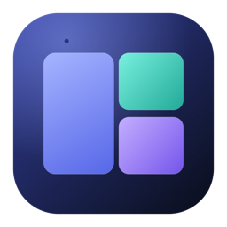

<p align="center">
  
</p>

<h1 align="center">Jailor</h1>

<p align="center"><strong>Persistent, label-aware workspace layouts for macOS.</strong></p>

<p align="center">
  
  
  
  
</p>

<p align="center">
  English · <a href="README.vi.md">Vietnamese</a>
</p>

Jailor assigns real application windows to named, labeled frames and remembers those assignments. It is not an automatic tiler or a virtual desktop: it moves, resizes, and focuses actual windows through the macOS Accessibility API.

> **Status: 0.0.1 (early alpha).** Requires macOS 14+. No prebuilt release yet.

## Features

- **Editable frames** — use presets or move/resize frames freely.
- **Multiple layouts** — separate workspaces for coding, meetings, research, etc.
- **Labels** — classify windows and set a preferred label per frame.
- **Quick assign** — drag windows, use the palette, or press a hotkey.
- **Workspace reveal** — hide the Jailor UI, tile the layout, and bring assigned windows to the front.
- **Dock / Cmd+Tab aware** — reveal the workspace instead of opening a blank app.
- **Auto restore** — restore the layout on launch and optionally reopen closed apps.
- **Fill empty frames** — place open, unassigned windows into empty frames.
- **Universal binary** — native on Apple Silicon and Intel.
- **Local JSON state** — no account, no network requests.

## Install

```bash
git clone https://github.com/wamynobe/jailor.git
cd jailor
make app
open build/Jailor.app
```

`make app` builds a universal, ad-hoc signed `build/Jailor.app` for arm64 and x86_64.

For a faster single-architecture build:

```bash
JAILOR_ARCHS="arm64-apple-macosx14.0" ./scripts/build-app.sh
JAILOR_ARCHS="x86_64-apple-macosx14.0" ./scripts/build-app.sh
```

## First run

1. Open `build/Jailor.app`.
2. Grant **Accessibility** when the banner appears.
3. Return to Jailor and click **Check again**.
4. If macOS asks you to quit and reopen the app, do so.

After a rebuild the ad-hoc signature changes; re-enable Accessibility if macOS asks.

## Use

1. Choose or create a layout.
2. Click **Edit** to adjust frames and set a target display.
3. Assign a window:
   - drag it from the sidebar into a frame, or
   - press `⌃⌥Space`, choose a label, then press `1–9`, or
   - press `⌃⌥1…9` to send the focused window to a frame.
4. Click **Apply** or press `⌘↩`.
5. For Dock/Cmd+Tab reveal, enable **Settings → Interface → Workspace mode**.

## Shortcuts

### Global

| Shortcut | Action |
|---|---|
| `⌃⌥Space` | Open the quick-assign palette |
| `⌃⌥1` … `⌃⌥9` | Assign the focused window to frame 1…9 |
| `⌃⌥R` | Hide the Jailor UI and reveal the workspace |

### Local

| Shortcut | Action |
|---|---|
| `⌘↩` | Apply the active layout |
| `⌘⇧R` | Hide the dashboard and reveal the workspace |
| `⌘0` | Open the dashboard |

### Palette

`1–9` assign · `Tab` / `←` / `→` change label · `Return` assign hovered · `Esc` close.

## How it works

- **Real windows** — Accessibility moves and resizes windows from other apps.
- **Stable identity** — assignments store a stable CGWindowID, then fall back to title/frame matching; ambiguous matches are reported missing rather than selecting a random window.
- **Exact focus** — reveal activates each app and makes the assigned window key, so an app with multiple windows does not show the wrong one.
- **Background hotkeys** — Carbon hotkeys plus an `NSEvent` global-monitor fallback; automatic termination and App Nap are disabled while Jailor runs.
- **Local state** — layouts, labels, and assignments live in `~/Library/Application Support/Jailor/state.json`.

## Limitations

- Accessibility permission is required.
- Some fullscreen windows, system dialogs, and apps with hard size limits cannot be tiled.
- Not sandboxed or Mac App Store compatible; direct distribution only.
- The build is ad-hoc signed; re-grant Accessibility after rebuilding.
- One layout targets one display. Windows on different Spaces may not appear together.
- User-created names (labels, frames, layouts) are not auto-translated.

## Development

```bash
make app      # universal release build
make test     # unit tests (10)
make icon     # regenerate the app icon
make clean
```

Project structure:

```text
Sources/Jailor/       App, state, Accessibility, layout engine, views
Tests/JailorTests/    Geometry, compatibility, identity, localization
scripts/              Build and icon generation
Resources/            Info.plist and AppIcon.icns
```

## License

MIT. See [LICENSE](LICENSE).

## Acknowledgements

Inspired by the window-management community: [Rectangle](https://github.com/rxhanson/Rectangle), [yabai](https://github.com/koekeishiya/yabai), [Amethyst](https://github.com/ianyh/Amethyst), [Hammerspoon](https://github.com/Hammerspoon/hammerspoon), [Loop](https://github.com/MrKai77/Loop), and [AltTab](https://github.com/lwouis/alt-tab-macos). Not affiliated with any of them.

---

Version **0.0.1** · Bundle ID `vn.quadbit.jailor`
